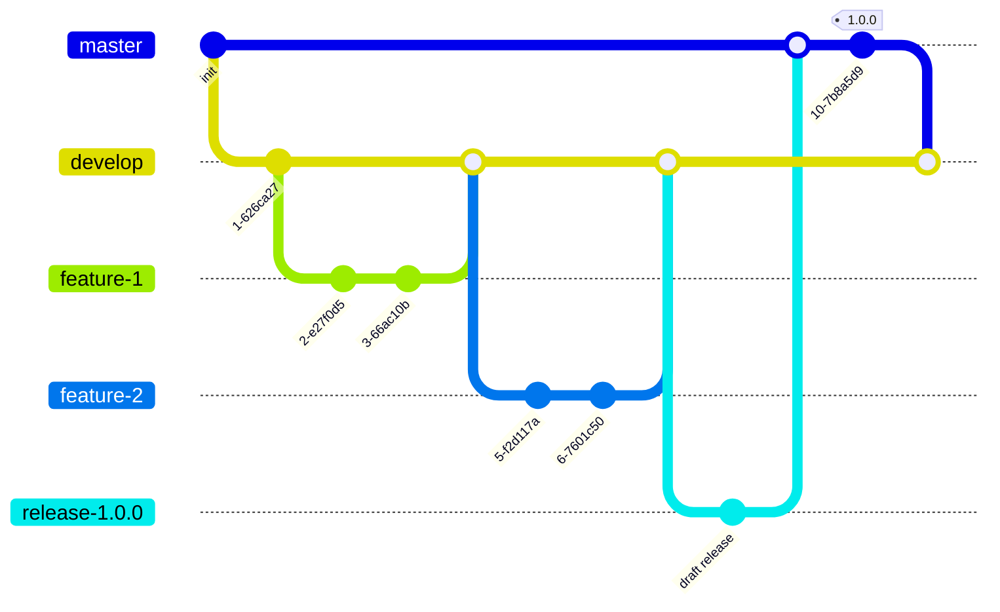

# Release workflow

S#arp Architecture is a set of NuGet packages, and releasing them is a deliberate, mostly
automated process. Package versions are never hardcoded — they are derived from the git
history by [GitVersion](https://gitversion.net), release notes are generated by
[GitReleaseManager](https://github.com/GitTools/GitReleaseManager) from GitHub milestones,
and [AppVeyor](https://www.appveyor.com) builds and publishes the packages.

The branching model is GitFlow: `develop` is the pre-release line, `master` is the stable
line.

## Versioning

- Create a **milestone** for the corresponding release in GitHub.
- Assign issues to the milestone.
- Assign **exactly one label** to each issue — the labels are what GitReleaseManager uses
  to build the release notes.

## Build process

- Create a `feature/` branch from `develop`.
- Merge it back into `develop` (squash the commits if needed).
- Delete the `feature/` branch.

Every build of `develop` publishes a pre-release (alpha) NuGet package, so features become
available as soon as they are merged.

## Release preparation

- **Close all issues to be released.** This is required for GitReleaseManager to pick
  them up into the release notes.
- Create a `release/` branch from `develop`.
- Do the remaining work on the release branch (update documentation, build scripts, etc.).
- Note: there should be **at least one commit / AppVeyor build** on the release branch, so
  that a draft release can be created on GitHub.
- Merge the release branch into `master`.

## Release

- Tag `master` with the version number — the tagged build is what publishes the stable
  packages to NuGet.
- Rebase `develop` on `master`:

  ```bash
  git checkout develop
  git pull --rebase origin master
  ```

- Delete the release branch.
- **Review and publish the release on GitHub** — this is a manual step, giving a chance to
  review the generated release notes before they go live.
- Update `PackageReleaseNotes` in `Src/Directory.Build.props` to point to the next
  milestone. All new beta versions will carry this link in their release notes on
  nuget.org; it will be overwritten by the tagged build.
- Commit the change without triggering a new build:

  ```bash
  git commit -m "[skip ci] Update release notes link to next milestone"
  ```

## Notes

1. Do not use text names for milestones (like `vNext`) — GitReleaseManager does not
   support them; milestone names must be version numbers.

## Workflow diagram

Diagrams can be edited at <https://mermaid.live>.


